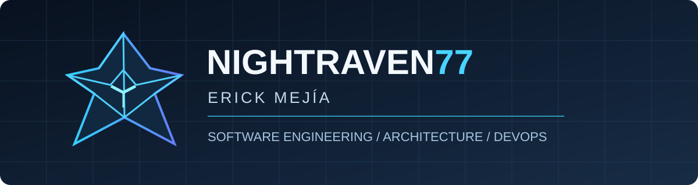

Full-Stack Developer · Software Architecture · DevOps

Building reliable systems. Improving what already exists. Automating what comes next.

About me

I'm Erick Mejía, a full-stack developer focused on enterprise software, maintainable architecture, system modernization, and delivery automation.

My work combines hands-on engineering with technical coordination: reviewing architecture and code, collaborating on requirements, maintaining business-critical modules, and improving how teams build and deploy software.

65 repositories migrated as part of a Git-based modernization effort.

5-developer team with responsibilities spanning reviews, task coordination, and requirements discussions.

4 application modules under my current development, coordination, and maintenance responsibilities.

Experience with CI/CD, branch protection, reporting performance improvements, and production systems.

I believe good software should be understandable today, dependable tomorrow, and adaptable when requirements change.

Engineering toolkit

Focus

Technologies & practices

Backend

C#, .NET, ASP.NET Core, Python, FastAPI, REST APIs

Frontend

Angular, Vue, TypeScript, JavaScript, HTML, CSS, Tailwind CSS

Data

SQL, PostgreSQL, relational modeling, query and reporting optimization

Delivery & operations

Git, Gitea, Gitea Actions, Woodpecker CI, Docker, IIS, Linux

Engineering

Code review, architecture review, technical coordination, CI/CD, maintainability

Selected projects

Equilibrium Vault · Personal finance PWA

A full-stack personal and shared-finance application for tracking income, expenses, credit cards, installment purchases, subscriptions, and savings goals. Its documented architecture combines Angular 19, FastAPI, Supabase/PostgreSQL, authentication, and PWA capabilities, with Docker-based deployment configuration.

What it showcases: multi-part application architecture, finance-domain workflows, authentication and data-access design.

Explore Equilibrium Vault →

My Gym Tracker · Offline-first workout tracking

A mobile-oriented Progressive Web App for workout logging, routines, progressive-overload analysis, estimated one-rep max, and exercise guidance. The repository documents a FastAPI backend, SQLite/PostgreSQL persistence, offline caching, visual exercise assets, and Chart.js analytics.

What it showcases: offline-first product design, analytical features, frontend/backend integration, and practical fitness workflows.

Explore registroGYM →

Pokémon Competitive Calculator · Team analysis & damage calculation

A competitive Pokémon teambuilder with documented damage calculations, type-coverage analysis, speed comparisons, and team import/export. Built with Vue 3, TypeScript, Pinia, and a FastAPI backend; the README also documents pytest and Ruff checks.

What it showcases: domain-specific calculation logic, interactive interfaces, typed frontend development, and test-oriented tooling.

Explore pokeCalculator →

QR Studio Pro · Desktop QR design tool

A Python desktop application for generating customized QR codes from URLs, contact details, Wi-Fi credentials, and other payloads. Its documented toolset includes CustomTkinter, Pillow, multiple visual styles, batch generation, and export to PNG, SVG, PDF, and JPEG.

What it showcases: desktop UI development, image processing, format handling, and packaging workflows.

Explore QR Studio Pro →

Professional engineering highlights

Enterprise application development. Contributed to production systems covering financial administration and donation management, including application maintenance, reporting, and performance optimization.

Repository modernization. Migrated 65 repositories and implemented protected-branch practices to support more structured collaboration and reviews.

Delivery automation. Worked with Woodpecker CI and Gitea Actions to establish build, test, review, and deployment workflows, including deployments to Windows Server/IIS environments.

Technical coordination. Participate in architecture and code reviews, requirements discussions, and work planning within a five-developer team.

Professional work is described at a high level to respect organizational confidentiality.

How I approach engineering

Clarity before complexity · Automation over repetition · Maintainability over shortcuts · Continuous improvement

Connect

GitHub

LinkedIn

GitLab

NightRaven77 · Software engineered to evolve.

